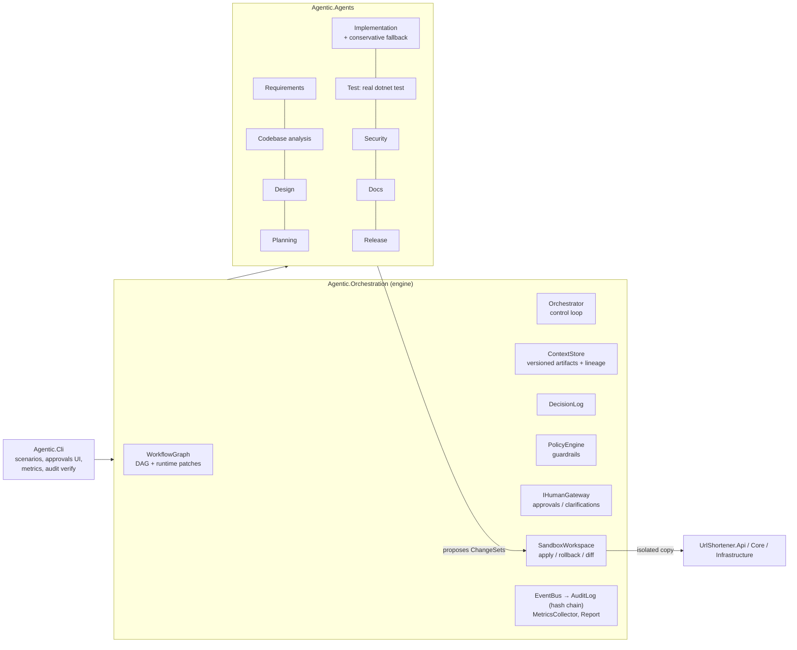
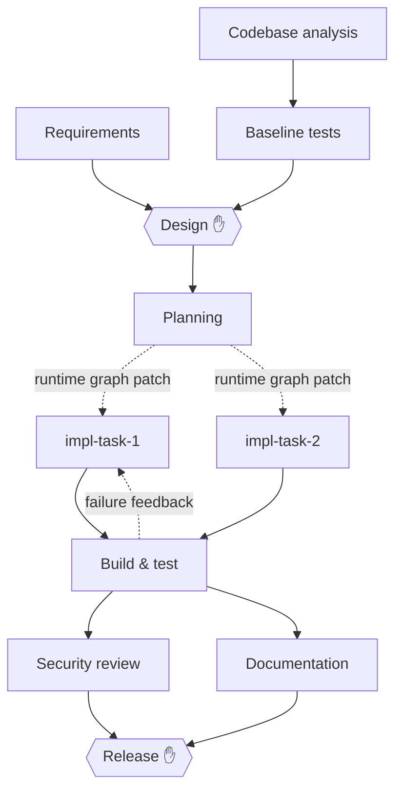

# Architecture & Engineering Summary

## 1. Problem framing

The goal is to turn a natural-language requirement (well-defined, brownfield or ambiguous) into a
*reviewable* engineering outcome: code, tests, docs, evidence and a release recommendation. The
whole SDLC is orchestrated by agents, and autonomy stays controlled throughout:

- **Agents may:** analyse, design, plan, propose changes and run builds and tests, inside a sandbox.
- **Agents may not:** guess blocking requirements, bypass guardrails, write outside their scope, or
  ship. Those decisions belong to humans.

## 2. Components

| Component | Responsibility | Key design choice |
|---|---|---|
| `WorkflowGraph` | Explicit DAG of stages, validated for cycles and dangling dependencies on creation **and on every runtime patch** | A planner cannot corrupt the graph; a bad patch is rejected atomically |
| `Orchestrator` | One control loop: readiness, entry/exit gates, policy, approvals, retries, fallback, feedback loops, re-plan, safe-stop | All state transitions are serialised on one loop; only agent work runs in parallel. Governance stays deterministic and auditable |
| `IAgent` | Does one stage's work and returns outputs, decisions and a *proposed* `ChangeSet` | Agents **cannot mutate** the workspace or context directly |
| `ContextStore` | Immutable, versioned artifacts. Each one records its producer, attempt, the exact input versions (`key@vN`) and a content hash | Lineage and stale-result detection come for free |
| `PolicyEngine` | Guardrails evaluated on every change set **before** it is applied | Verdicts are Allow / RequireApproval / Deny |
| `SandboxWorkspace` | Per-run copy of the codebase. Records prior content for exact rollback, confines paths to its root and produces the diff | Nothing touches the real repository |
| `IHumanGateway` | The only source of human authority: console, scripted (`scripted:*`), or deny-all for unattended runs | The safe default is to deny |
| `AuditLog` / `MetricsCollector` | Both are derived from the same event stream | Metrics can never disagree with the audit trail |

## 3. Orchestration model and control flow

### SDLC graph (brownfield/ambiguous variant)

✋ marks a mandatory human checkpoint. Greenfield omits the codebase-analysis branch.

### Per-stage lifecycle

1. **Ready:** a stage is ready when all its dependencies have succeeded and any backoff has elapsed.
   Up to `MaxParallelism` ready stages run at once.
2. **Entry gates:** check that required inputs exist. If a gate fails, the stage is blocked and the
   run safe-stops.
3. **Execute:** the agent runs with a timeout. The engine snapshots the versions of the inputs the
   stage consumes.
4. **Clarify:** if the agent asks questions, the run pauses for a human. The answers become a new
   artifact version, and the stage re-runs; this does not count as a failure. The number of rounds
   is bounded.
5. **Policy:** every proposed change set is evaluated. A Deny is a failed attempt, and the
   workspace is never touched.
6. **Apply:** the change is written to the sandbox, with prior content recorded so it can be undone.
7. **Exit gates:** if any fails, the change is **rolled back** and the attempt fails.
8. **Approval:** required by `RequiresApproval`, by impact at or above the threshold, or by a policy
   RequireApproval finding.
   - **Reject** → roll back and safe-stop.
   - **Approve with changes** → the amended artifacts are recorded as authored by the human, which
     triggers a re-plan.
9. **Commit:** outputs are stored with lineage, decisions are recorded, and any graph patch is applied.
10. **Re-plan check:** any completed stage whose consumed inputs now have a newer version is
    invalidated along with its dependents. Their workspace changes are rolled back newest-first, and
    they re-run.

### Failure handling

| Mechanism | Trigger | Bound |
|---|---|---|
| Retry with backoff + feedback | Attempt failed (error, timeout, gate, policy) | `RetryPolicy.MaxAttempts` per stage |
| Fallback agent | Retries exhausted | Once per stage |
| Feedback loop (non-linear) | A downstream stage attributes its failure to upstream stages, e.g. a failing test mapped to the task that claimed it | `MaxFeedbackLoops` (3) |
| Rollback | Exit gate failed, approval rejected, invalidation or re-plan | Exact, per change set |
| Re-plan | An upstream artifact gets a new version | `MaxReplans` (3) |
| Safe-stop | Unrecoverable failure, rejection, kill switch, Ctrl+C, duration or attempt budget exhausted | Running stages cancelled, pending stages Skipped, optional full rollback |

## 4. Governance guardrails

| Policy | Category | Verdict |
|---|---|---|
| `SEC-001-secrets`: keys, tokens, passwords in added lines | Security | Deny |
| `SEC-002-dependency-allowlist`: new `PackageReference` not on the approved list | Supply chain | Deny |
| `SEC-003-authz` (security review): write endpoint without `ApiKeyFilter` | Security | Deny |
| `CMP-001-pii-logging`: log statement containing raw IP or email | Compliance | Deny |
| `CHG-001-protected-paths`: modifying `Program.cs`, `*.csproj`, schema, build props; any deletion | Change control | RequireApproval |
| `CHG-002-change-size`: more than 12 files or 600 lines | Change control | RequireApproval |
| `AUT-001-write-scope`: writes outside `src/`, `tests/`, `docs/`, README, CHANGELOG | Autonomy | Deny |
| Impact ≥ High, design and release stages | Change control | Human approval |
| Blocking ambiguity | Requirements | Must be answered by a human (gate enforces it) |

## 5. Observability and reliability metrics

- **Audit:** `audit.jsonl` records every event (gates, attempts, policy findings, approvals,
  rollbacks, re-plans, artifacts, decisions). Each entry embeds the previous entry's hash, and
  `verify-audit` detects any edit, deletion or reordering.
- **Lineage:** each artifact `.meta.json` lists the exact upstream versions it was derived from.
  Each decision records its actor, rationale, the alternatives considered, and the artifact versions
  it was based on.
- **Metrics per run, aggregated by `agentic metrics`:**
  - attempt and run success rate
  - retries, fallbacks, rollbacks, feedback loops, re-plans
  - policy findings and denials, approvals requested and rejected
  - **MTTR**: the mean time from a stage's first failure to its recovery
  - **end-to-end latency**, plus human wait time reported separately
  - a per-attempt timeline

Measured on this machine (scripted approvals):

| Scenario | Outcome | Latency | Attempts (ok) | Rollbacks | Feedback loops | Fallbacks | Re-plans | MTTR |
|---|---|---|---|---|---|---|---|---|
| greenfield | succeeded | ~8 s | 12 (100%) | 0 | 0 | 0 | 0 | n/a |
| brownfield | succeeded | ~16 s | 12 (92%) | 1 | 1 | 0 | 0 | ~4 s |
| ambiguous | succeeded | ~12 s | 14 (93%) | 0 | 0 | 1 | 1 | ~0 s (policy-blocked attempt recovered immediately by the fallback) |

## 6. Key decisions and trade-offs

| Decision | Why | Trade-off |
|---|---|---|
| Engine-owned side effects (agents propose, the engine applies) | Every change passes policy, gates, approval and can be rolled back | Agents can't do "anything"; new capabilities need new contracts |
| Single control loop + parallel workers | Deterministic, auditable governance with real concurrency | Approvals pause commits of other stages while waiting |
| Versioned artifacts + consumed-version snapshots | Re-plan is precise: only stale stages and their dependents re-run | More bookkeeping than passing objects between steps |
| Failure attribution (`FeedbackTargets`) | Fixes go to the stage that caused the failure, instead of blindly retrying the test | Needs a task-to-test mapping (`VerifiedBy`) from planning |
| Deterministic reasoning + curated change catalog | Reproducible demos, testable governance, no API keys, offline | Not truly generative; covers the scenarios in the catalog. `IReasoningProvider` and `ChangeCatalog` are the seams for an LLM |
| Sandbox under `%TEMP%` | Isolation; avoids Windows MAX_PATH failures under deep repo paths | The workspace lives apart from the run report (path is printed in the report) |
| URL shortener: random 7-char Base62, 302 + no-store, hashed client address, result types → ProblemDetails, built-in rate limiter, SQLite WAL behind repository ports | Security (no enumeration, SSRF and credential checks), accurate analytics, privacy by design, clean layering | 302 costs a round-trip on every visit; per-IP limits penalise NAT; SQLite is single-node |

## 7. Limitations

1. **No real LLM in the loop.** Requirement interpretation uses keyword and domain rules, and
   implementation picks from reviewed candidate strategies. It shows *orchestration and governance*
   faithfully, but it would not handle arbitrary new requirements: unknown capabilities fail safely
   to "needs human triage".
2. **Not resumable.** If the process crashes, the run cannot be continued (the audit log and
   artifacts remain). A durable state store and idempotent stages would be needed.
3. **Single process.** There is no distributed workers or queue, and approvals are synchronous on
   the console.
4. **The policies are heuristics** (regex), not full SAST, secret scanning or licence tools. In
   production they would call real scanners behind the same `IPolicy` interface.
5. **URL shortener scale and security limits:**
   - Clicks are written synchronously on the hot path.
   - A hostname that resolves to a private IP is not detected (DNS rebinding).
   - Per-IP rate limiting assumes no reverse proxy (ForwardedHeaders are not configured).
   - The API key is a single shared secret.
6. **The scripted reviewer is for demos.** `--auto-approve` must never be used for real changes. It
   is clearly labelled `scripted:*` in the audit trail.

## 8. Assumptions

- "Reliable" and "secure" in the greenfield requirement were resolved as documented assumptions
  (see each run's report). Blocking ambiguities are never assumed.
- The brownfield defect is simulated by removing the expiry guard from a copy of the codebase, which
  mirrors a real regression.
- Release means producing a signed-off, reviewable package (diff, report, audit). Promoting the
  sandbox diff to the main branch stays a human action.

## 9. Validation strategy (how we know it works)

- **81 automated tests:** 61 for the service and 20 for the orchestrator. The orchestrator tests
  cover each governance behaviour in isolation with fake agents.
- **Three end-to-end scenarios** run the real agents and the real compiler and test runner on a
  sandbox. Each scenario's report shows tests passing, the policy findings and every human decision.
- **Tamper-evident audit** with independent verification (`verify-audit`).
